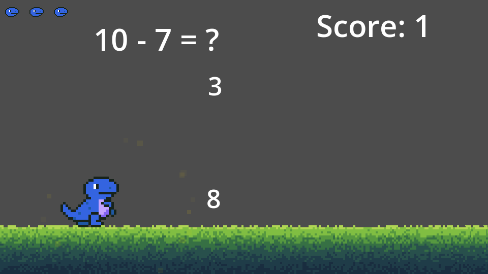

# Math Runner

A fast-paced mathematical runner game inspired by Chrome's dinosaur game. Test your math skills while dodging obstacles!

**Play it in the browser:** <https://fredsoe.io/mathrunner> (keyboard, mouse, or
tap the screen on an iPad or phone).

## Description

Math Runner combines quick arithmetic with platformer mechanics. Players must solve simple arithmetic problems (plus, minus, multiply or divide) while running and jumping, creating an exciting blend of mental and reflexive challenges. The game progressively gets faster, testing both your mathematical ability and timing skills.

### Features

- Simple one-button controls
- Progressive difficulty
- Four dinos to pick from, one for each kind of problem: plus, minus, multiply and divide
- Endless runner gameplay
- Score tracking

## Getting Started

### Dependencies

- Godot 4.7
- No additional dependencies required

### Installing

- Download and install [Godot Engine](https://godotengine.org/download)
- Clone this repository or download the ZIP file
- Open the project in Godot using the project.godot file
- The `Web` export preset produces the browser build. It has threads turned off, so the result runs as plain static files on any web server

### How to Play

- Pick a dino in the main menu (click or tap it, or use the arrow keys and SPACE) - the game starts right away
- SPACE, a mouse click or a tap on the screen makes your character jump
- To answer equations:
  - Jump to select the top answer
  - Stay on the ground to select the bottom answer
- After a game over, jump to try again or press "Pick another dino". ESC also takes you back to the main menu
- Score points by selecting correct answers
- Game speeds up over time
- Try to survive as long as possible!

## Credits

- Game inspired by Chrome's dinosaur game
- The dino and the ground are made for this game by `tools/make_assets.py`. The four dino colors are made in the game with a shader
- Correct and wrong answer sounds: recorded by Adam
- Jump sound: recorded by Adam & Lilli for [Jumpy Boi](https://github.com/fredsoe-io/jumpy-boi)

## Version History

- 0.2
  - Main menu with four dinos: plus, minus, multiply and divide
  - The correct answer explodes when you pick it
  - Plays in the browser, also on a touch screen
- 0.1
  - Initial Release
  - Basic gameplay mechanics implemented

## License

- The code and the generated art are released under the [MIT license](LICENSE).
- The sounds in `assets/sounds/` were recorded by Adam & Lilli. They belong to them and are not licensed for reuse.
