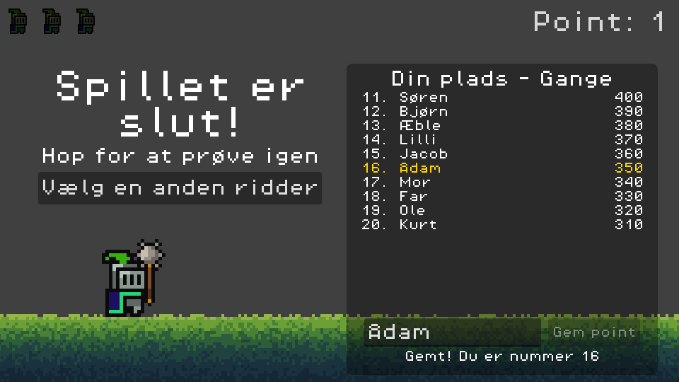

# Math Runner

A fast-paced mathematical runner game inspired by Chrome's dinosaur game. Test your math skills while dodging obstacles!

**Play it in the browser:** <https://fredsoe.io/mathrunner> (keyboard, mouse, or
tap the screen on an iPad or phone).




## Description

Math Runner combines quick arithmetic with platformer mechanics. Players must solve simple arithmetic problems (plus, minus, multiply or divide) while running and jumping, creating an exciting blend of mental and reflexive challenges. The game progressively gets faster, testing both your mathematical ability and timing skills.

### Features

- Simple one-button controls
- Progressive difficulty
- Four knights to pick from, one for each kind of problem: Sir Addalot (plus, sword), Sir Minusalot (minus, spear), Sir Timesalot (multiply, mace) and Sir Dividealot (divide, axe)
- Your knight swings its weapon at the answer it runs into
- A scoreboard for each knight: type your name after a game to save your score
- In English and Danish: the game starts in the browser's language, and the button in the corner of the main menu switches
- Endless runner gameplay
- Score tracking

## Getting Started

### Dependencies

- Godot 4.7
- No additional dependencies required

### Installing

- Download and install [Godot Engine](https://godotengine.org/download)
- Clone this repository or download the ZIP file
- Open the project in Godot using the project.godot file
- The `Web` export preset produces the browser build. It has threads turned off, so the result runs as plain static files on any web server

### Scoreboard

The scores live in a small API (`fredsoe-io/scoreboard`, a private repo)
at `/api/scoreboard` on the same site as the game. In the browser
the game talks to the site it was loaded from; in the editor the scoreboard is
off unless `scoreboard_url` in `scripts/global_config.gd` points at a running
API, e.g. `http://localhost:8000`.

The game signs each score with a key. Export the web build with

```sh
SCOREBOARD_KEY=... tools/export_web.sh
```

The script writes the key to `secrets/scoreboard.cfg`, which git ignores and
the `Web` preset packs into the build. A key inside a browser game is not
really secret, so the API also checks every score against the time since the
game started; see the scoreboard repo for how.

### Translations

The Danish text is in `translations/translations.csv`. The English text is the
key, so English needs no column of its own. When Godot imports the project it
turns the CSV into `translations/translations.da.translation`; commit that file
too, because the game loads it before the first import has made it. Godot
translates text in scenes by itself, and text set from code goes through
`tr()`. The knights' names stay English on purpose.

### How to Play

- "Dansk" / "English" in the top right corner of the main menu switches the language
- Pick a knight in the main menu (click or tap it, or use the arrow keys and SPACE) - the game starts right away
- SPACE, a mouse click or a tap on the screen makes your character jump
- To answer equations:
  - Jump to select the top answer
  - Stay on the ground to select the bottom answer
- After a game over you see the top 10 for your knight. Type your name and press "Save score" (or Enter) to save your score; the board then shows where it landed, with the 5 scores above it and 4 below, even if that is number 623. The game remembers your name for next time
- Jump to try again or press "Pick another knight". ESC also takes you back to the main menu
- Score points by selecting correct answers
- Game speeds up over time
- Try to survive as long as possible!

## Credits

- Game inspired by Chrome's dinosaur game
- The knight: "Camelot" by [analogStudios_](https://analogstudios.itch.io/camelot), CC0, as repackaged in [Brackeys' Platformer Bundle](https://brackeysgames.itch.io/brackeys-platformer-bundle). It is the same knight as in [Jumpy Boi](https://github.com/fredsoe-io/jumpy-boi). The four knight colors are made in the game with a shader
- The weapons, the ground and the app icon are made for this game by `tools/make_assets.py`
- Font: Pixel Operator 8 by Jayvee Enaguas (HarvettFox96), CC0 1.0 (it says so in the font file), the same font as in Jumpy Boi
- Correct and wrong answer sounds: recorded by Adam
- Game over sound: recorded by Adam & Lilli for [Jumpy Boi](https://github.com/fredsoe-io/jumpy-boi), where it is the knight's death sound

## Version History

- 0.3
  - The dinos are now knights, each with its own weapon: sword, spear, mace and axe
  - The knight swings its weapon at the answer it runs into
  - A game over sound, from Jumpy Boi
  - No jump sound any more: it was long and played over the right and wrong answer sounds
  - A scoreboard for each knight
  - The pixel font from Jumpy Boi
  - Danish, with a button in the main menu to switch language
- 0.2
  - Main menu with four dinos: plus, minus, multiply and divide
  - The correct answer explodes when you pick it
  - Plays in the browser, also on a touch screen
- 0.1
  - Initial Release
  - Basic gameplay mechanics implemented

## License

- The code and the generated art are released under the [MIT license](LICENSE).
- The knight sprite (`assets/images/knight.png`) and the font (`assets/fonts/PixelOperator8.ttf`) are CC0, see Credits.
- The sounds in `assets/sounds/` were recorded by Adam & Lilli. They belong to them and are not licensed for reuse.
